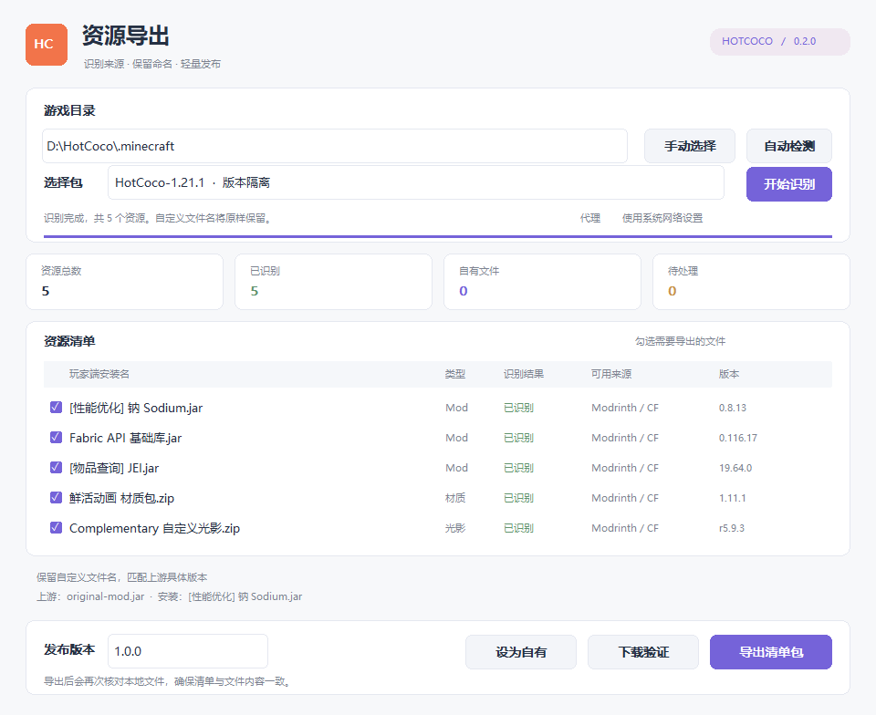

# HotCoco 资源导出工具

轻量的 Windows 原生资源导出工具，使用 Rust、Win32、WinHTTP 和 Windows CNG。当前版本 **0.2.0**，Windows x64 单文件 EXE 约 **1.03 MiB**，无需 Python、Java 或 .NET。

## 下载和使用

在 [Releases](https://github.com/LZJ-I/hotcoco-exporter/releases) 下载 EXE 或便携 ZIP。私有仓库的下载需要有仓库访问权限。

推荐将 EXE 放到 `.minecraft` 同级：

```text
HotCoco/
├─ HotCoco.exe
├─ HotCoco-Exporter-0.2.0.exe
└─ .minecraft/
   └─ versions/
      ├─ 包A/
      │  ├─ mods/
      │  ├─ resourcepacks/
      │  └─ shaderpacks/
      └─ 包B/
```

1. 双击 EXE，自动检测附近的游戏目录；也可手动选择或拖入文件夹。
2. 在“选择包”中选择版本。只有一个包时自动选中，多个包必须明确选择。
3. 点击“开始识别”，通过文件内容匹配 Modrinth／CurseForge 项目和准确版本。
4. 勾选要导出的资源。未知文件可排除，或明确标记为自有资源。
5. 填写发布版本，点击“导出清单包”。可再使用“下载验证”还原到全新目录并核对内容。

代理留空时使用系统网络设置，也可以填写 `127.0.0.1:7897` 等明确代理地址。



## 导出规则

- 发布者的本地文件名就是部署名，保留中文、空格和括号；上游原名仅作为下载来源信息。
- 以 `.minecraft/versions/包名/` 为隔离边界，分别读取所选版本的 `mods`、`resourcepacks`、`shaderpacks`。
- 所选版本没有资源时不会回退读取共享 Mod；其他包和 `.minecraft` 根目录的共享资源不会混入。
- 第三方资源只导出来源、项目／版本 ID、下载地址、路径、大小和哈希。
- 自有资源经维护者明确标记后，按原路径放入导出包。未知文件不会自动打包为自有资源。
- 导出前再次核对原文件；下载验证检查大小及 SHA-1、SHA-256、SHA-512、MD5。
- 仅接受资源目录下的 JAR／ZIP，单文件限制为 256 MiB。

当前范围是资源导出和还原验证。Minecraft 本体安装、正式启动器更新、GitHub 网页发布尚未接入。

## 构建

已验证的构建环境：WSL 中已有的 Rust、`x86_64-pc-windows-gnu` 目标和 MinGW。依赖版本由 `Cargo.lock` 锁定。

在 Windows PowerShell 的仓库目录运行：

```powershell
.\build-wsl.ps1
```

脚本使用 WSL 登录环境，执行离线构建，不自动安装工具链或依赖。新环境需先准备对应编译目标、MinGW 和 Cargo 依赖缓存。

输出位置：`target/x86_64-pc-windows-gnu/release/hotcoco-exporter.exe`。

核心测试：

```sh
cargo test --offline
```

## 命令行

图形界面与命令行使用相同的业务代码。

```powershell
# 自动发现 EXE 同级的 .minecraft
.\HotCoco-Exporter-0.2.0.exe discover --report discovery.json

# 指定目录，检测其中的包
.\HotCoco-Exporter-0.2.0.exe discover D:\HotCoco --report packs.json

# 从多个隔离版本中选定一个导出；输出位置需要在实例目录之外
.\HotCoco-Exporter-0.2.0.exe export D:\HotCoco --instance HotCoco-A --output client.hotcoco.zip --version 1.0.0

# 按需增加 --own mods/自有文件.jar，或 --exclude mods/排除的文件.jar
# 路径有空格时请使用引号

# 下载到全新目录进行还原验证
.\HotCoco-Exporter-0.2.0.exe restore client.hotcoco.zip --destination D:\HotCoco-Test --report receipt.json

# 内置自测，不访问真实游戏目录
.\HotCoco-Exporter-0.2.0.exe self-test --workdir D:\Exporter-SelfTest --report self-test.json
```

联网命令可以追加 `--proxy 127.0.0.1:7897`，还原命令可通过 `--provider curseforge` 优先尝试该来源。

## 验证记录

- 15 项核心测试，包括多包选择、版本隔离、空版本边界、目录优先级、中文版本名和安全路径。
- 10 项 Windows EXE 内置自测，包括系统哈希、自有资源还原、已有目录保护、错误哈希和文件变化处理。
- 5 个真实资源完成隔离包导出及下载还原，文件名与哈希一致；联网实测使用本机代理。
- [版本隔离验证](docs/validation/isolation-0.2.0.json)、[Windows 自测](docs/validation/native-self-test-0.2.0.json)。

`docs/preview.png` 为程序生成的离屏预览。测试下载的第三方资源和编译缓存不属于仓库内容。

## 项目结构

```text
src/core.rs       扫描、来源识别、清单、导出与还原
src/instances.rs  游戏目录发现、版本隔离及包选择
src/gui.rs        原生界面和离屏预览
src/net.rs        WinHTTP 请求、代理和下载地址校验
src/hashes.rs     Windows CNG 哈希及 CurseForge 指纹
src/main.rs       图形／命令行入口及内置自测
build.rs          图标、版本信息、清单和链接资源
build-wsl.ps1    使用已有 WSL 工具链离线构建
```
